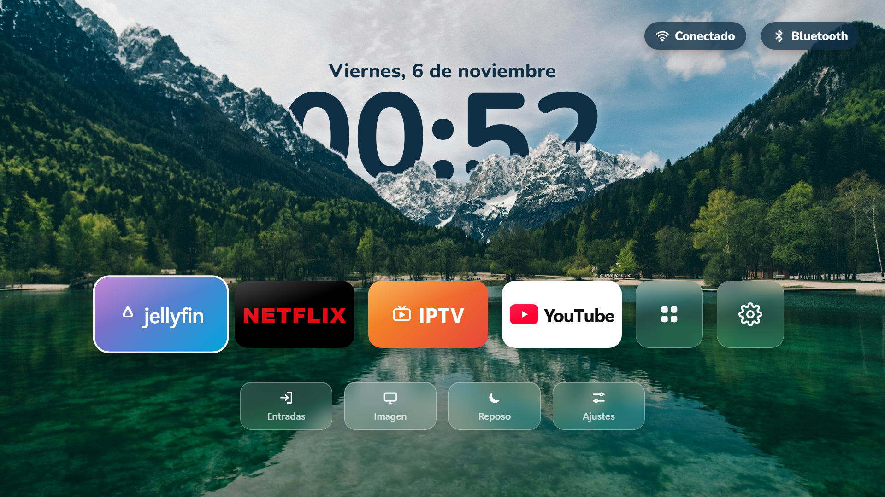
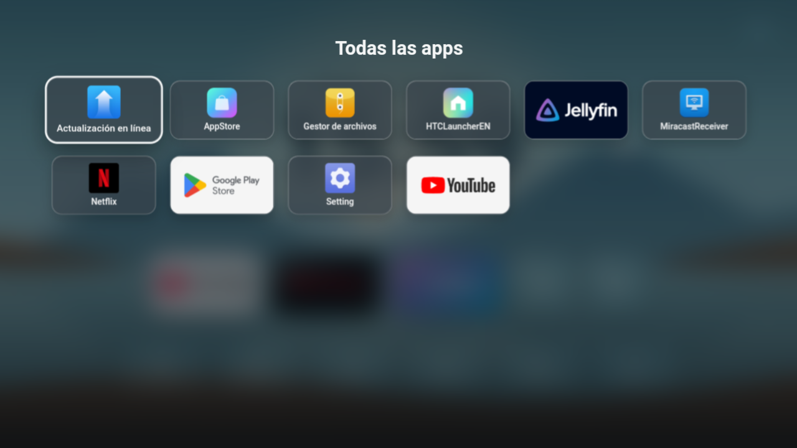

# Inicio TV — a beautiful home screen for Android TV

🇪🇸 [Leer en español](README.md)

An Apple‑style home screen for **Android TV** sets and boxes (Android 5 or newer). It's the TV version of [hy300-proyector](https://github.com/dn0z1986/hy300-proyector).



> ⭐ **If you like it, give it a star** (top right): it helps other people find it.

- A lake and mountains wallpaper with **the clock hidden behind the mountains** (depth effect).
- Big tiles for **Jellyfin, Netflix, IPTV and YouTube**, plus "All apps" and Settings.
- **Wi‑Fi** (shows your network name) and **Bluetooth** (shows the connected device, e.g. headphones) buttons in the top‑right corner. Select them with the remote to open their settings.
- Shortcuts: **Entradas** (inputs: HDMI and channels), **Imagen** (picture), **Reposo** (screensaver) and **Ajustes** (settings).
- Everything works with the remote's arrows and OK button.

> The interface is in Spanish. All the text is in `android-tv-launcher/assets/index.html` if you want to translate it.



## Install

### Without a computer

1. Get the APK onto the TV in one of these two ways:
   - With the **Downloader** app (by AFTVnews, available on Google Play). Enter this address:
     ```
     https://github.com/dn0z1986/inicio-android-tv/releases/latest/download/Inicio-AndroidTV.apk
     ```
   - Or download `Inicio-AndroidTV.apk` from [Releases](../../releases) on another device, copy it to a **USB stick** and open it with a file manager on the TV.
2. If it asks for permission to **install unknown apps**, allow it and press **Install**.
3. Press the **Home** button on the remote. If it asks which home screen to use, choose **Inicio** and **Always**.

If it doesn't ask and the TV's own home screen keeps showing (almost always the case on Google TV), the app is installed (you'll find it in the app list), but to make it the home screen you need to do step 5 below once from a computer.

### With a computer (ADB)

You need a computer with **ADB** ([Android platform-tools](https://developer.android.com/tools/releases/platform-tools)), on the same Wi‑Fi as the TV or connected by USB.

1. On the TV, go to **Settings → System → About** and press **Build** 7 times to enable Developer options.
2. In **Developer options**, turn on **USB debugging** (and **Network debugging** if your TV has it). The TV's IP address is in Settings → Network.
3. Connect, and accept the prompt on the TV:
   ```
   adb connect TV_IP_ADDRESS:5555
   ```
   If your TV has **Wireless debugging** (Android 11 or newer), pair it first with `adb pair IP:PORT` using the code shown on the TV.
4. Download `Inicio-AndroidTV.apk` from [Releases](../../releases) and install it:
   ```
   adb install -r Inicio-AndroidTV.apk
   ```
5. Set it as the home screen:
   ```
   adb shell cmd package set-home-activity com.inicio.tv/.MainActivity
   ```
6. Press the **Home** button on the remote.

### If it's Google TV and its own home screen keeps coming back

Google TV keeps restoring its own launcher. You can disable it (check the exact name first with `adb shell pm list packages launcher`):
```
adb shell pm disable-user --user 0 com.google.android.apps.tv.launcherx
```
To undo it: `adb shell pm enable com.google.android.apps.tv.launcherx`.

### Uninstall

```
adb uninstall com.inicio.tv
```

## App tiles

This app **does not include** Netflix, YouTube, Jellyfin or IPTV: it opens the ones you have installed. If one is missing, you get a message.

| Tile | Packages it looks for (in order) |
|---|---|
| Jellyfin | `org.jellyfin.androidtv`, `org.jellyfin.mobile` |
| Netflix | `com.netflix.ninja`, `com.netflix.mediaclient` |
| IPTV | `com.nst.iptvsmarterstvbox` (IPTV Smarters Pro) |
| YouTube | `com.google.android.youtube.tv`, `com.google.android.youtube`, `com.teamsmart.videomanager.tv` |
| Entradas | The TV's channels/inputs app (Google, Sony, TCL, Xiaomi, Philips, MediaTek). If none is found, it opens Settings. |

## Customize and build

The whole screen is a web page (`android-tv-launcher/assets/index.html`) inside a tiny Android app, so you can change the design without knowing Android. To try it in a browser, open `index.html` and use the keyboard arrows.

To build on Windows you need **JDK 17** and the **Android SDK** (build-tools 34 and platform 34). The script looks for them in `%LOCALAPPDATA%\hy300-tools\jdk17` and `%LOCALAPPDATA%\hy300-tools\sdk`; if yours are elsewhere, edit the first lines of `build.ps1`. Then:
```
powershell -ExecutionPolicy Bypass -File android-tv-launcher\build.ps1
```

**Change the wallpaper:** replace `assets/fondo.jpg` (1920×1080) and cut out the mountains that cover the clock again:
```
powershell -ExecutionPolicy Bypass -File android-tv-launcher\tools\recortar-montanas.ps1
```

## Credits

- Wallpaper: Lake Jasna (Slovenia), from [Unsplash](https://images.unsplash.com/photo-1559310589-2673bfe16970), under the [Unsplash License](https://unsplash.com/license).
- Font: [Nunito](https://fonts.google.com/specimen/Nunito), SIL Open Font License.
- Netflix, YouTube, Jellyfin and IPTV Smarters are trademarks of their owners. This project is not affiliated with them.
