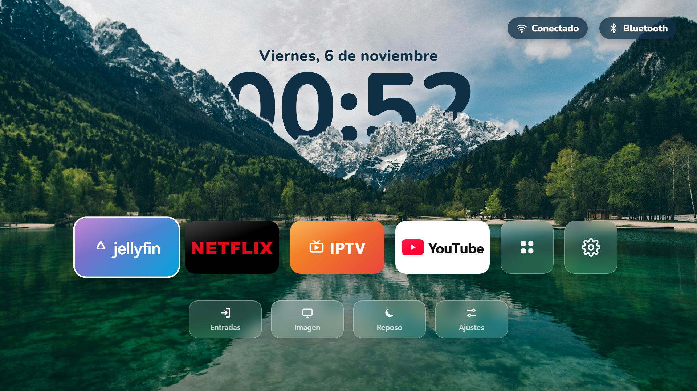
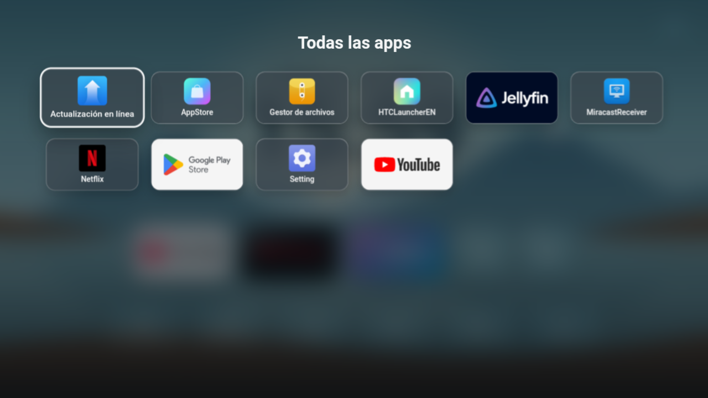

# Inicio TV — pantalla de inicio bonita para teles Android TV

🇬🇧 [Read in English](README.en.md)

Una pantalla de inicio "tipo Apple" para teles y cajas **Android TV** (Android 5 o más nuevo). Es la versión para tele de [hy300-proyector](https://github.com/dn0z1986/hy300-proyector).



> ⭐ **Si te gusta, dale una estrella** (arriba a la derecha): así más gente lo encuentra.

- Fondo de un lago con montañas, y **la hora escondida detrás de las montañas** (efecto profundidad).
- Botones grandes para **Jellyfin, Netflix, IPTV y YouTube**, más "Todas las apps" y Ajustes.
- Arriba a la derecha, botones de **Wi‑Fi** (con el nombre de tu red) y **Bluetooth** (con el aparato conectado, por ejemplo unos auriculares). Se eligen con el mando y abren sus ajustes.
- Accesos rápidos: **Entradas** (HDMI y canales), **Imagen**, **Reposo** y **Ajustes**.
- Todo se maneja con las flechas y el OK del mando.



## Instalarlo

### Sin ordenador

1. Pasa el APK a la tele de una de estas dos formas:
   - Con la app **Downloader** (de AFTVnews, está en Google Play). Escribe esta dirección:
     ```
     https://github.com/dn0z1986/inicio-android-tv/releases/latest/download/Inicio-AndroidTV.apk
     ```
   - O descarga `Inicio-AndroidTV.apk` de [Releases](../../releases) en otro aparato, cópialo a un **pendrive** y ábrelo con un explorador de archivos en la tele.
2. Si te pide permiso para **instalar apps desconocidas**, dáselo y pulsa **Instalar**.
3. Pulsa el botón **Inicio** del mando. Si te pregunta qué pantalla de inicio usar, elige **Inicio** y **Siempre**.

Si no te pregunta y sigue saliendo la pantalla de la tele (pasa casi siempre en Google TV), la app ya está instalada (la verás en la lista de apps), pero para ponerla como pantalla de inicio hay que hacer una vez el paso 5 de abajo con un ordenador.

### Con ordenador (ADB)

Necesitas un ordenador con **ADB** (las [platform-tools de Android](https://developer.android.com/tools/releases/platform-tools)), en la misma Wi‑Fi que la tele o conectado por USB.

1. En la tele, entra en **Ajustes → Sistema → Información** y pulsa 7 veces en **Compilación** para activar las Opciones de desarrollador.
2. En **Opciones de desarrollador**, activa **Depuración USB** (y **Depuración por red** si la hay). La IP de la tele está en Ajustes → Red.
3. Conéctate y acepta el aviso que sale en la tele:
   ```
   adb connect IP_DE_LA_TELE:5555
   ```
   Si tu tele tiene **Depuración inalámbrica** (Android 11 o más nuevo), primero vincúlala con `adb pair IP:PUERTO`, usando el código que sale en la tele.
4. Descarga `Inicio-AndroidTV.apk` de la sección [Releases](../../releases) e instálalo:
   ```
   adb install -r Inicio-AndroidTV.apk
   ```
5. Ponlo como pantalla de inicio:
   ```
   adb shell cmd package set-home-activity com.inicio.tv/.MainActivity
   ```
6. Pulsa el botón **Inicio** del mando.

### Si es Google TV y sigue saliendo su pantalla

Google TV vuelve a poner su propio inicio. Se puede desactivar (busca antes el nombre exacto con `adb shell pm list packages launcher`):
```
adb shell pm disable-user --user 0 com.google.android.apps.tv.launcherx
```
Para deshacerlo: `adb shell pm enable com.google.android.apps.tv.launcherx`.

### Quitarlo

```
adb uninstall com.inicio.tv
```

## Apps de los botones

La app **no trae** Netflix, YouTube, Jellyfin ni IPTV: abre las que tengas instaladas. Si alguna no está, sale un aviso.

| Botón | Paquetes que busca (en orden) |
|---|---|
| Jellyfin | `org.jellyfin.androidtv`, `org.jellyfin.mobile` |
| Netflix | `com.netflix.ninja`, `com.netflix.mediaclient` |
| IPTV | `com.nst.iptvsmarterstvbox` (IPTV Smarters Pro) |
| YouTube | `com.google.android.youtube.tv`, `com.google.android.youtube`, `com.teamsmart.videomanager.tv` |
| Entradas | La app de canales/entradas de la tele (Google, Sony, TCL, Xiaomi, Philips, MediaTek). Si no la encuentra, abre los Ajustes. |

## Cambiar el diseño y compilar

Toda la pantalla es una página web (`android-tv-launcher/assets/index.html`) dentro de una app Android muy pequeña, así que se puede cambiar el diseño sin saber Android. Para probarla en el navegador, abre `index.html` y usa las flechas del teclado.

Para compilar en Windows hace falta **JDK 17** y el **Android SDK** (build-tools 34 y platform 34). El script los busca en `%LOCALAPPDATA%\hy300-tools\jdk17` y `%LOCALAPPDATA%\hy300-tools\sdk`. Si los tienes en otro sitio, cambia las primeras líneas de `build.ps1`. Después:
```
powershell -ExecutionPolicy Bypass -File android-tv-launcher\build.ps1
```

**Cambiar el fondo:** cambia `assets/fondo.jpg` (1920×1080) y vuelve a recortar las montañas que tapan la hora:
```
powershell -ExecutionPolicy Bypass -File android-tv-launcher\tools\recortar-montanas.ps1
```

## Créditos

- Foto del fondo: lago Jasna (Eslovenia), de [Unsplash](https://images.unsplash.com/photo-1559310589-2673bfe16970), con la [licencia de Unsplash](https://unsplash.com/license).
- Tipografía: [Nunito](https://fonts.google.com/specimen/Nunito), con la licencia SIL Open Font License.
- Netflix, YouTube, Jellyfin e IPTV Smarters son marcas de sus dueños. Este proyecto no tiene relación con ellos.
